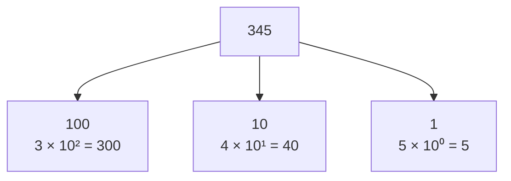

# binary-calc

This project started as I was taking a gander through a [Boot.dev](https://www.boot.dev/) Python course as a way to display credentials on my professional resume.

The lesson covered binary numbers and decimal-to-binary conversion, but rather than simply learning the concept and moving on, I wanted to implement the logic myself and better understand how computers represent numbers.

The goal of this project is to build a binary conversion utility from scratch using Bash while documenting the reasoning behind the implementation. The project serves as both a learning exercise and a demonstration of practical problem-solving, scripting, and self-directed learning.

---

## What is Binary

Binary is a [base-2 numeral system](https://en.wikipedia.org/wiki/Binary_number).

In the decimal (base-10) system we use every day, there are ten available digits: `0`, `1`, `2`, `3`, `4`, `5`, `6`, `7`, `8`, `9`

Each position in a decimal number represents a power of 10.

### Example

`345`

```plaintext
3 x 100
4 x 10
5 x 1
```

We represent this as **100** *3 times*, **10** *4 times*, and **5** *1 time*.

Computers operate using a binary (base-2) numbering system instead. Binary uses only two possible digits, called **bits**.

Because only two symbols are available, each position *represents* a power of **2** rather than a power of **10**.

### What are bits

A bit (binary digit) is the smallest unit of data in a binary number.

A bit can only contain one of two values, a `0` or a `1`. Each position in a binary number represents a power of 2.

Starting from the right-most position:

| Position | Value in bits |
| -------- | ------------- |
| 1 | 1 |
| 2 | 2 |
| 3 | 4 |
| 4 | 8 |


