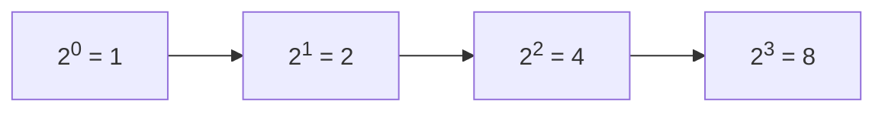
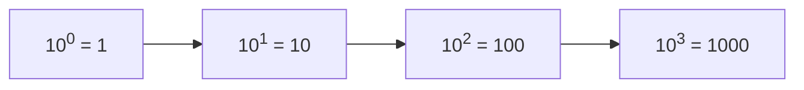

# binary-calc

This project started as I was taking a gander through a [Boot.dev](https://www.boot.dev/) Python course as a way to display credentials on my professional resume.

The lesson covered binary numbers and decimal-to-binary conversion, but rather than simply learning the concept and moving on, I wanted to implement the logic myself and better understand how computers represent numbers.

The goal of this project is to build a binary conversion utility from scratch using Bash while documenting the reasoning behind the implementation. The project serves as both a learning exercise and a demonstration of practical problem-solving, scripting, and self-directed learning.

---

## What is Binary

Binary is a [base-2 numeral system](https://en.wikipedia.org/wiki/Binary_number).

In the decimal (base-10) system we use every day, there are ten available digits: `0`, `1`, `2`, `3`, `4`, `5`, `6`, `7`, `8`, `9`

Each position in a decimal number represents a power of 10.

### What are bits

A bit (binary digit) is the smallest unit of data in a binary number.

A bit can only contain one of two values, a `0` or a `1`. Each position in a binary number represents a power of 2.

### Converting Base-10 to Base-2

To convert decimal to binary, we first find the powers of 2 that make up the number.

Take `13` as an example:

We know this is the formula for Base-2:

> *a* x $2^n$



And We know this is the formula for Base-10:

> *a* x $10^n$



To convert a decimal number into binary, we find the powers of 2 that can be added together to make the original number.

Take for example the number `13`:

Starting with the largest place value (8), we determine whether each power of 2 can fit into the remaining value.

| Place Value | Remaining Value | Binary Digit |
| ----------- | --------------- | ------------ |
| 8 | 13 | 1 |
| 4 | 5 | 1 |
| 2 | 1 | 0 |
| 1 | 1 | 1 |

Therefore:

> $13_{10}$ = $1101_2$

#### Example

Computers operate using a binary (base-2) numbering system instead. Binary uses only two possible digits, called **bits**.

Because only two symbols are available, each position *represents* a power of **2** rather than a power of **10**.

So, we need to find the max base-2 power and work backwards.

To find the highest binary place value, we determine the largest power of 2 that is less than or equal to the number. Mathematically, this can be expressed as:

> $n = |\log_2(x)|$

This means our number, *n*, is equal to the absolute value of the $\log_2(x)$.

A logarithm is the exponent to which a fixed base must be raised to produce a given number y:

> $\log_b(y) = x$

For `13`:

> $|\log_2(13)| = 3$

Base-2 conversion:

> $2^3 = 8$

`13 - 8` is `5`, which means we need to repeat:

> $|\log_2(5)| = 2$

Base-2 conversion:

> $2^2 = 4$

`5-4` = `1`, we know any number to the power of 0 is 1.

This means:

```text
 8    4    2    1
[x]  [x]  [ ]  [x]
 1    1    0    1
```

Therefore:

> $13_{10}$ = $1101_2$
